<p><h1 align="center">S010.基于SpringBoot小程序的乡村特产推广管理系统</h1></p>

###  获取完整源码和sql数据库文件（完全免费）:  微信: littlepinia88 qq：1104515926
###  所有项目以及源代码本人均调试运行无问题 可支持远程安装部署调试、定制修改、代码讲解

## 简介

> 本代码来源于网络,仅供学习参考使用!
>
> 提供1.远程部署/2.修改代码/3.设计文档指导/4.框架代码讲解等服务
>
> 访问地址：http://localhost:9527
> 
> 管理员：admin 123456
> 
> 用户：fds 1
> 
> 商户：irene 123
>

## 项目介绍
本项目是一个基于 Spring Boot 的乡村特产推广管理系统，采用「小红书式笔记 + 特产电商」的双内容形态，由微信小程序（用户与商户端）、Vue 后台管理端与 Spring Boot 后端三部分组成，打通特产商品发布购买、笔记种草、笔记审核认证、用户反馈的完整业务闭环，可作为小程序 + 前后端分离项目的实践案例。

### 系统角色
- **用户**：在小程序注册登录，浏览搜索笔记与特产、购买商品、发表笔记、评论笔记、反馈问题，对应 `user` 表中 `role=USER` 的账号。
- **商户**：在小程序注册登录，在用户能力之外可发布特产商品、查看已售商品与待发货订单。
- **管理员**：登录 Vue 后台管理端，维护用户、商品、笔记审核与认证、笔记评分、反馈与特产分类。
- **权限控制**：后端 `AuthInterceptor` 校验 JWT（jjwt 0.9.0）令牌，登录接口签发 Token，受保护接口需在请求头携带令牌；CORS 由 `CorsConfig` 统一配置放行。

### 小程序端模块概览
首页笔记流、发表笔记、笔记详情与评论点赞、特产商品浏览与详情、下单购买与收货、我的笔记、商户已售商品、个人资料、修改密码、切换城市、问题反馈。

### 管理端模块概览
仪表盘统计、用户管理、商品管理、笔记审核、笔记达人认证、笔记评分管理、反馈管理、特产分类管理。

### 技术栈
- **后端框架**：Spring Boot 2.6.3、Spring MVC，JDK 1.8。
- **数据访问**：tk.mybatis 通用 Mapper 2.1.5（mapper-spring-boot-starter），MySQL，开启驼峰命名映射。
- **鉴权与上传**：JJWT 0.9.0 签发登录令牌，阿里云 OSS SDK 3.10.2 存储图片与认证材料。
- **小程序端**：微信原生小程序（`wx/`），自带首页/发表/我的 tabBar。
- **管理端**：Vue 2 + Element-UI（vue-element-admin 模板，`xuliyan-web/`），Axios 调用后端接口。
- **工程能力**：Lombok 简化 POJO、`GlobalExceptionHandler` 全局异常处理、统一 `JsonResult` 响应封装。

### 核心数据表
- `user` 用户表：姓名、密码、头像、角色 `role`（ADMIN/USER/MERCHANT 枚举）、所在地 `location`、性别、年龄、手机号、籍贯。
- `merchant` 商户表：关联用户 `userId`、店铺名 `storeName`、身份证 `idcard`、地址、联系方式、经营产品。
- `node` 笔记表：标题、内容、图片、视频、地址、发布用户 `userId`、关联商户、浏览量 `pageview`、审核状态 `auditStatus`、状态 `status`、认证材料 `authorizedFile`。
- `node_comment` 笔记评论表：父评论 `parentId`、所属笔记 `nodeId`、评论人 `fromId`、回复对象 `toId`、内容。
- `node_like` 笔记点赞评分表：笔记 `nodeId`、用户 `userId`、评分 `score`。
- `goods` 特产商品表：标题、内容、价格 `price`、图片、库存 `inventory`、发布用户 `userId`。
- `user_goods` 用户订单表：用户 `userId`、商品 `goodsId`、下单时间。
- `node_goods` 笔记关联商品表：笔记 `nodeId`、商品 `goodsId`。
- `category` 特产分类表、`feedback` 反馈表（内容、回复内容、反馈人）、`menu` 后台菜单表。

### 工程结构
```
S010xuliyan
├── xuliyan/                 Spring Boot 后端
│   └── src/main/java/com/example/lrb
│       ├── controller/      REST 控制器（含 api/ 小程序接口）
│       ├── service/ + impl/ 业务层
│       ├── dao/             tk.mybatis Mapper 接口
│       ├── pojo/            实体（user、merchant、node、goods…）
│       ├── enums/           RoleEnums、NodeEnums
│       └── config/          CORS、Web、数据格式化配置
├── wx/                      微信原生小程序（pages/、components/、api/）
├── xuliyan-web/             Vue + Element-UI 后台管理端（src/views）
└── screenshot/
```

### 补充说明
- 后端服务端口 8080，管理端默认开发端口 9527；数据库库名 `s010_xuliyan`，首次运行需建库并导入表结构。
- 商品与笔记图片上传至阿里云 OSS（配置见 `application.yaml`），非本地磁盘存储。
- 下单购买为流程模拟，未接入真实支付渠道。

## 功能描述
管理员：
基本操作：登录、完善个人信息、获取个人信息、修改密码
用户管理：获取用户列表、搜索用户、重置用户密码、删除用户
商品管理：获取商品列表、搜索商品、修改商品库存、删除库存
反馈管理：获取反馈列表、搜索反馈、删除反馈
笔记管理：获取笔记审核列表、搜索笔记审核、获取笔记认证列表、筛选笔记认证、上传笔记认证材料、修改笔记认证状态（通过、拒绝）、获取笔记评分列表、搜索笔记评分、删除笔记

用户：
基本操作：登录、注册、修改密码、切换城市、分享小程序、反馈问题
笔记模块：获取笔记列表、搜索笔记、发表笔记、获取我的笔记列表、查看笔记详情、评论笔记
商品模块：购买商品、查看商品详情、查看等待发货商品

商户：
基本操作：登录、注册、修改密码、切换城市、分享小程序、反馈问题
笔记模块：获取笔记列表、搜索笔记、发表笔记、获取我的笔记列表、查看笔记详情、评论笔记
商品模块：购买商品、查看商品详情、查看等待发货商品
商品模块：获取商品列表、发布商品、查看已售商品列表

## 环境

- <b>IntelliJ IDEA 2021.3</b>

- <b>Mysql 5.7.26</b>

- <b>微信开发者工具</b>

- <b>JDK 1.8</b>

## 运行截图


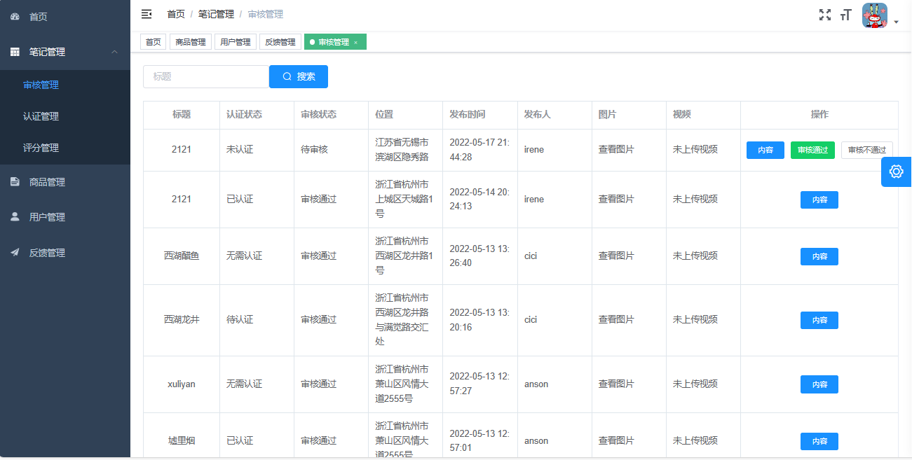

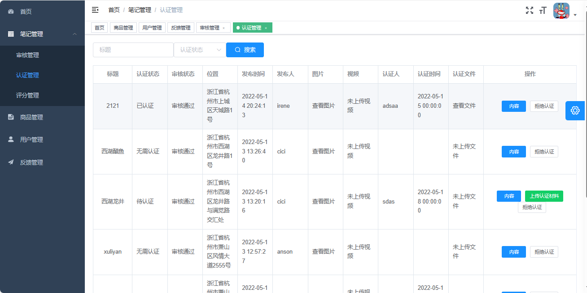

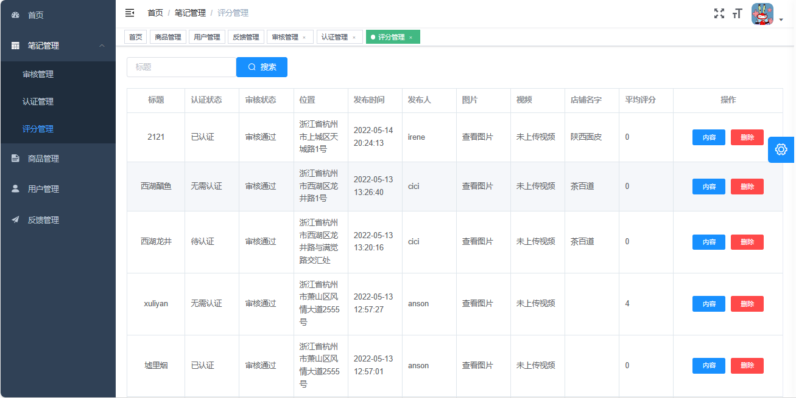

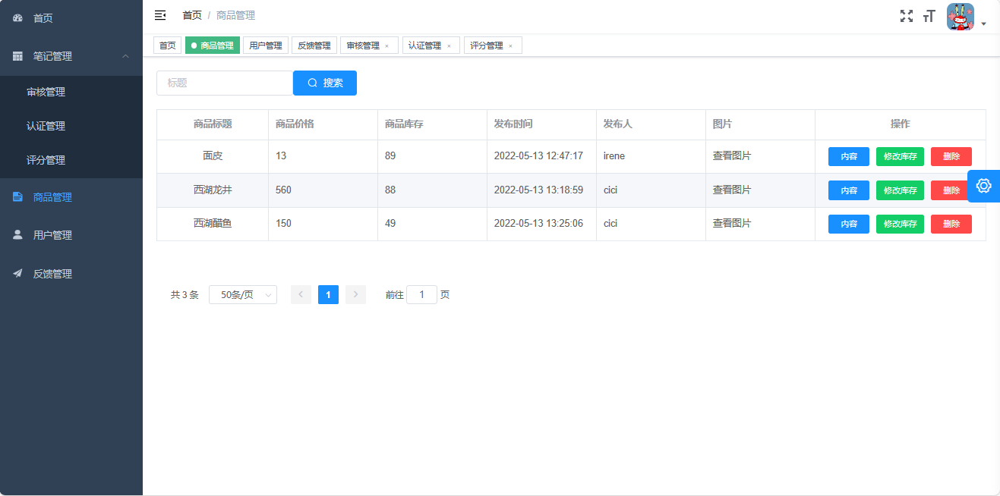

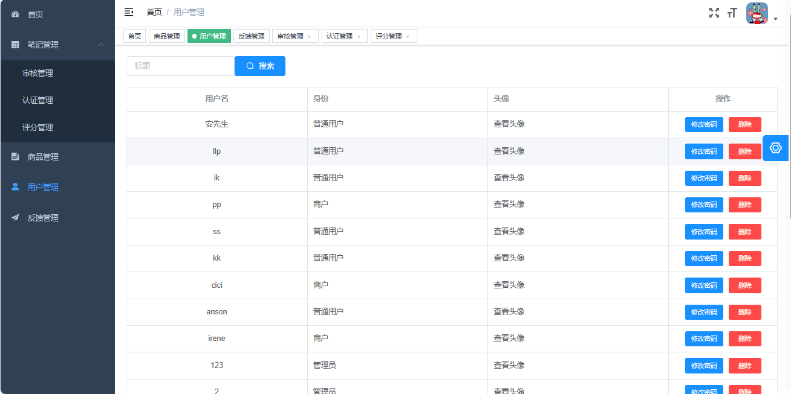

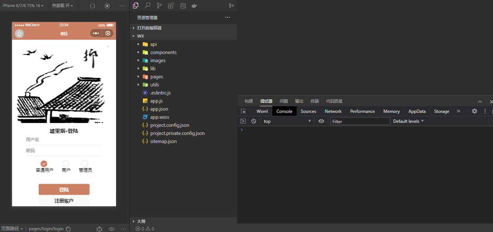

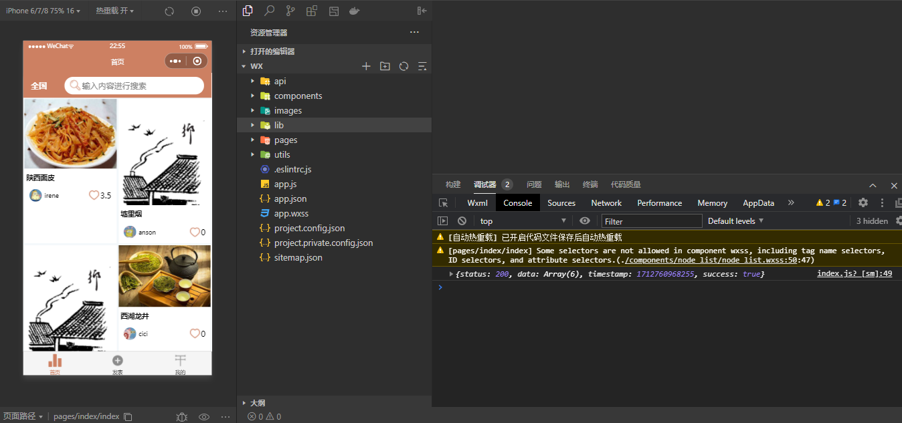

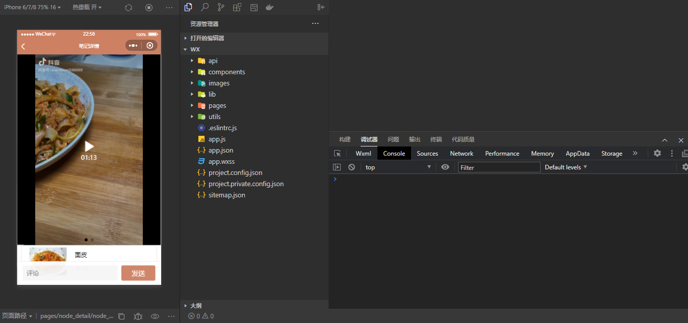

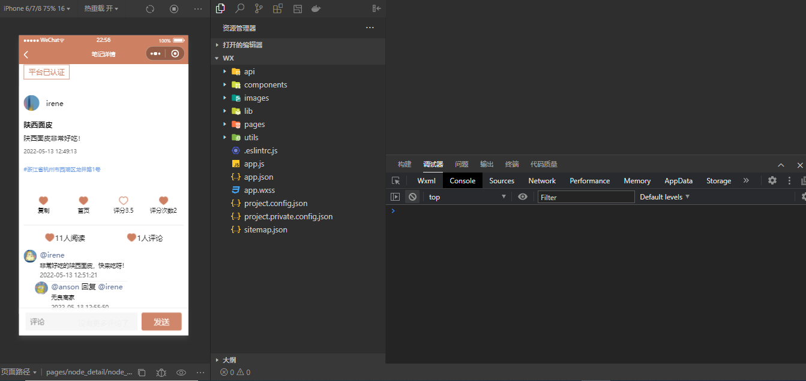

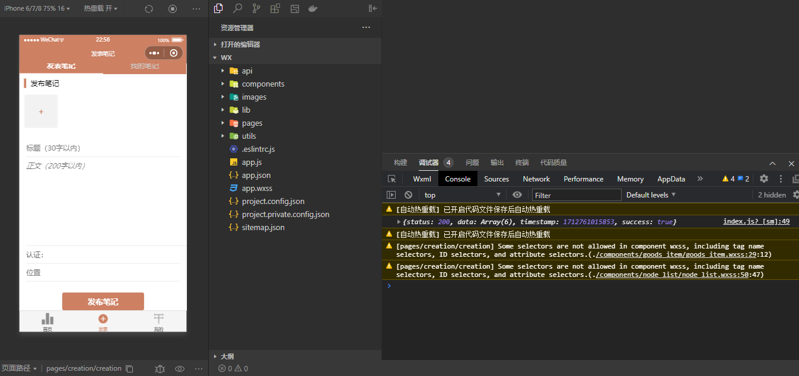

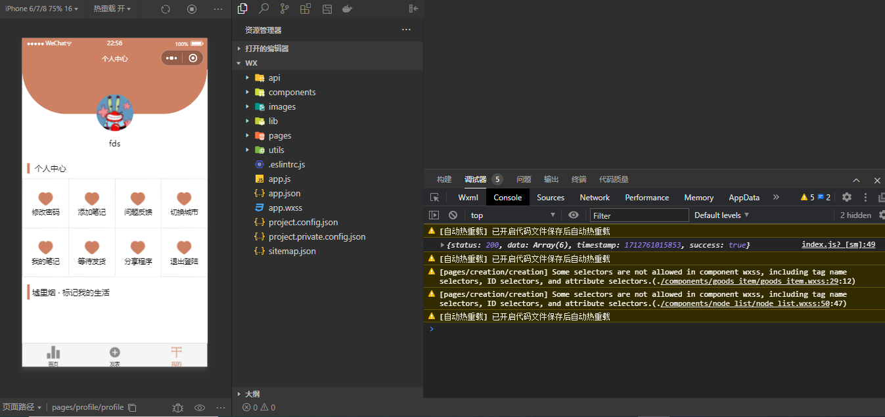

